# GasDeck — visninger og sensoroppsett

[Home](../README.md) | [English](Display-gallery.md) | [Oppsett](Konfigurasjon-norsk.md)

Ekte **800 × 480 skjermopptak fra X20RS-simulatoren, ETHOS 26.1.2**, med stabil GasDeck 2026.10-v7. Instrumentene og modellbildene tegnes av appen i simulatoren. Telemetrien er kontrollerte illustrasjonsdata; det var ingen fysisk mottaker eller sensor tilkoblet. Valgene under hvert bilde forteller hvordan visningen settes opp.

## Deck og Digital, med og uten bilde

<table>
<tr>
<td><a href="images/native-gasdeck-deck-photo.png">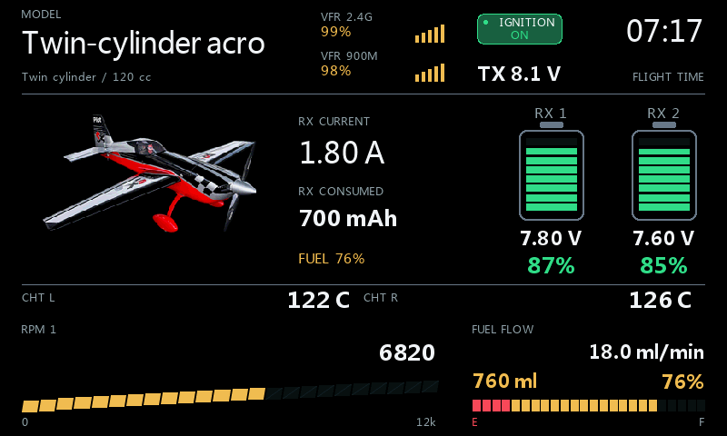</a> <b>Deck / modellbilde</b></td>
<td> <b>Deck / Hidden</b></td>
</tr>
<tr>
<td><a href="images/native-gasdeck-digital-photo.png">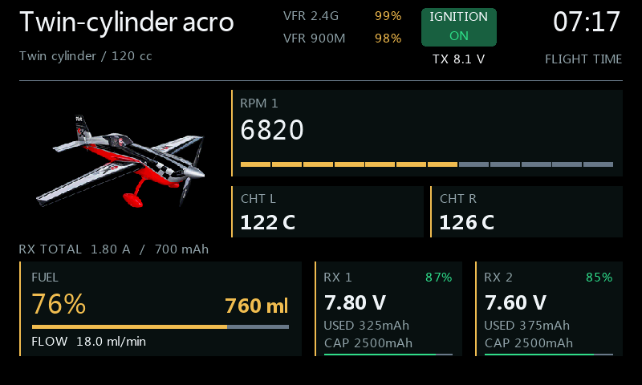</a> <b>Digital / modellbilde</b></td>
<td> <b>Digital / Hidden</b></td>
</tr>
</table>

Velg **Appearance > Display style = Deck / Digital** og deretter **Image source = Image file / Selected model / Hidden**. Bildene her bruker Image file. Selected model gir samme bildeflate med bildet som er valgt i ETHOS-modellen. Bare eksplisitt Hidden omfordeler plassen; en bildefeil gjør ikke det. Deck er standard. Bilde- og stilvalg endrer ingen kilde eller beregningsmetode.

## Valgene i programmet

Åpne widgetmenyen og velg **Configure widget > Appearance**. **Display style** og **Image source** er separate valg. Kildevelgerne må settes til telemetrien som faktisk er oppdaget på egen radio; illustrasjonsdataene tilordner ingen sensorer automatisk.

<table>
<tr>
<td>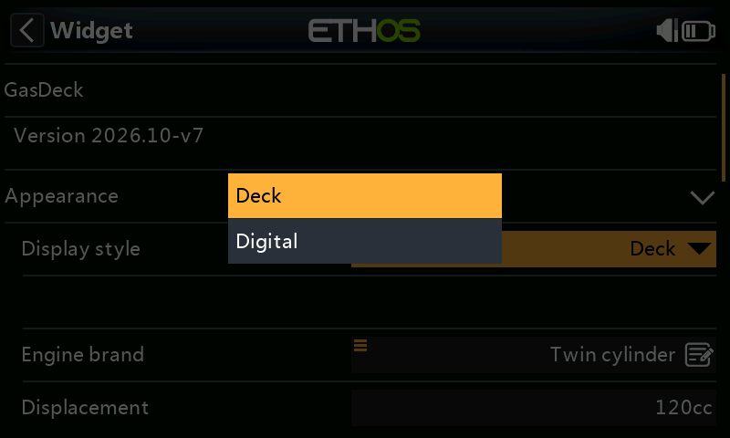 <b>Display style</b></td>
<td>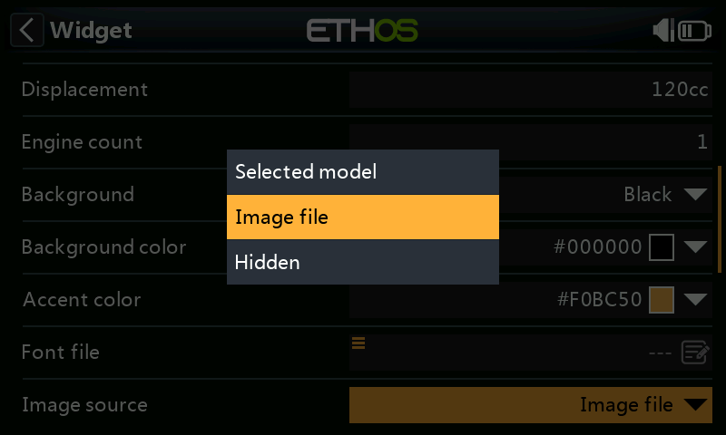 <b>Image source</b></td>
</tr>
</table>

Hovedbildene bruker **Engine count = 1**, **RPM displays = 1**, **Temp displays = 2**, **RPM style = Retro LCD**, **Temperature unit = Celsius**, **Tank value from = Integrate flow** og **RX1/RX2 Remaining from = Consumed mAh**. Begge RX-batterier er **LiPo / 2 cells / 2500 mAh**, tanken er **1000 ml**, **Flow input units = Auto** (ml/min i dette eksemplet), kalibrering **100 %** og reserve **20 %**. **RF displays = 2** med VFR i prosent. Firemotorsbildene bytter til **Engine count/RPM displays/Temp displays = 4/4/4**, **Displacement = 20 cc** per motor og B-24-bilde; resten av oppsettet er det samme.

## Modell, verdier og telemetri

Hovedbildet representerer et **stort acrofly med én 120 cc tosylindret bensinmotor**: **Engine count = 1**, **RPM displays = 1**, **Temp displays = 2**. CHT L og CHT R er to sylindertemperaturprober, ikke to motorer. Det medfølgende Pilot-RC-bildet illustrerer denne flytypen; vi påstår ikke at akkurat modellen på bildet har denne motoren installert.

**B-24-skalaeksemplet** bruker fire tenkte 20 cc motorer, fire målte RPM-kanaler og fire CHT-kanaler. Bildet passer dermed til motorantallet. Tankinstrumentet viser fortsatt ett samlet drivstoffsystem og må få en felles/summert måling som dekker motorene det representerer.

| Rolle i programmet | Telemetri i eksemplene | Aktuelt oppsett |
| --- | --- | --- |
| RX1 / RX2 voltage | Separat batterispenning — V | Mottaker/strømfordeler med måling av begge batteritilførslene |
| RX1 / RX2 consumed | Separate forbrukstellere — mAh | Uavhengig strøm-/forbruksmåling for hvert batteri |
| RX total | Samlet strøm — A; samlet forbruk — mAh | Målt totalstrøm og teller / ETHOS Consumption |
| RPM 1–4 | Uavhengig mekanisk turtall — rpm | AES II RPM-innganger eller kompatibel tredjeparts motortelemetri |
| Temp 1–4 | Uavhengige CHT-prober — °C | AES II med prober som passer de valgte inngangene, eller kompatibel temperaturtelemetri |
| Flow | Øyeblikkelig drivstoffstrøm — ml/min | AES II med kompatibel flowmeter; velg aktuell flow, ikke gjennomsnitt/maksimum |
| Fuel used / remaining | Volum eller gjenværende prosent | Velg rollen som Tank value from faktisk trenger |
| Ignition | Faktisk status eller bryter-/kanalkommando | En kommando beviser ikke at tenningen har strøm |
| RF / TX / timer | VFR %, senderspenning V, modelltimer s | Oppdagede mottaker-, radio- og modellkilder |

Hovedverdier: RX1 7,80 V / 87 % / 325 mAh, RX2 7,60 V / 85 % / 375 mAh, 2500 mAh per batteri. Samlet forbruk er 700 mAh og strømmen 1,80 A. Tank 1000 ml, gjenværende 760 ml / 76 %, flow 18,0 ml/min. Ikke del en samlet forbrukskilde i to oppdiktede tellere for hvert batteri.

**Engine count**, **RPM displays** og **Temp displays** er uavhengige. Én motor kan ha fire prober; flere motorer kan ha færre sensorer. Null skjuler instrumentfamilien uten å fremstille en manglende måling som null.

Se [FrSkys AES II-beskrivelse](https://www.frsky-rc.biz/ws/frsky-advanced-engine-suite-ii-aes-ii.html) og [FrSkys AES II-manual](https://www.flyingtech.co.uk/wp-content/uploads/2024/05/Advanced-Engine-Suite-II-Manual.pdf) for RPM-, temperatur- og flowinnganger og krav til elektrisk tilkobling/prober. AES II har flere temperaturinnganger enn GasDecks fire visningsfelt; velg probene du trenger. Tredjepartstelemetri kan brukes når ETHOS tilbyr riktig numerisk måling og enhet. Kontroller protokoll og inngangskompatibilitet uavhengig av antallet visningsfelt.

## Antall RPM- og temperaturfelt

Alle 25 kombinasjoner av 0–4 RPM og 0–4 temperaturfelt i Deck, med Hidden. Klikk et bilde for full oppløsning. Motorantallet følger RPM-antallet i disse eksemplene (minst én motor); temperaturantallet er uavhengig. Enkeltmotoreksempler med 3–4 temperaturer representerer flere målepunkter, ikke ekstra sylindre eller motorer.

<table>
<tr>
<td><a href="images/native-gasdeck-deck-rpm0-temp0.png">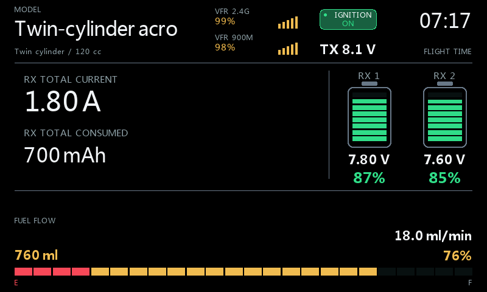</a> <b>0 RPM / 0 temperaturfelt</b></td>
<td><a href="images/native-gasdeck-deck-rpm0-temp1.png">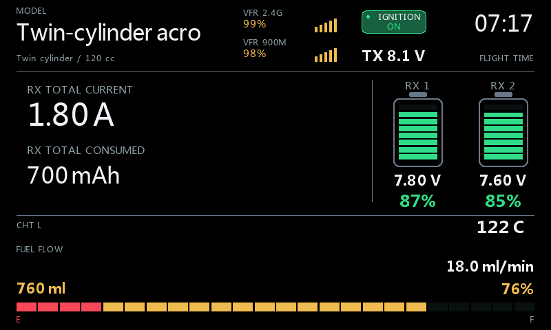</a> <b>0 RPM / 1 temperaturfelt</b></td>
<td><a href="images/native-gasdeck-deck-rpm0-temp2.png">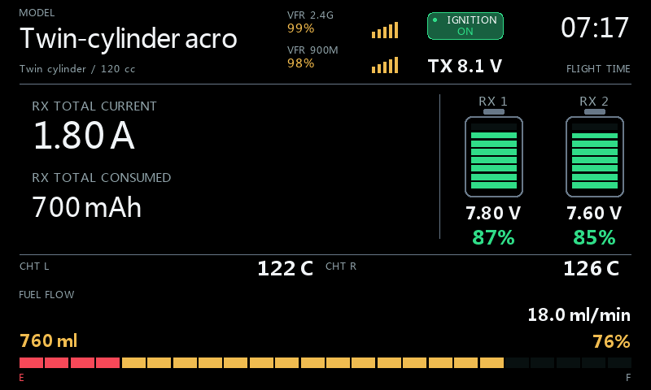</a> <b>0 RPM / 2 temperaturfelt</b></td>
<td><a href="images/native-gasdeck-deck-rpm0-temp3.png">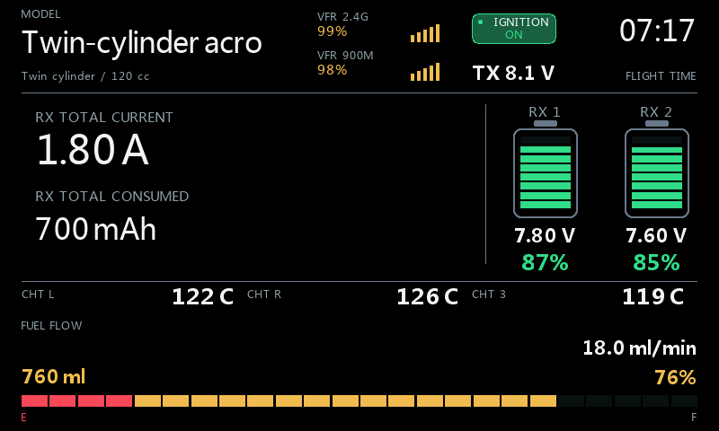</a> <b>0 RPM / 3 temperaturfelt</b></td>
<td><a href="images/native-gasdeck-deck-rpm0-temp4.png">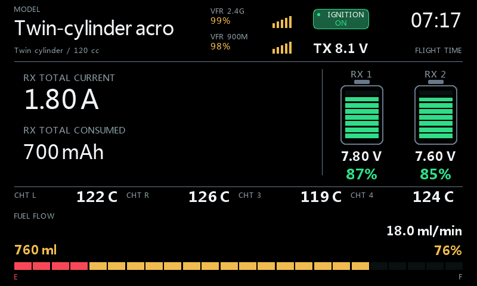</a> <b>0 RPM / 4 temperaturfelt</b></td>
</tr>
<tr>
<td><a href="images/native-gasdeck-deck-rpm1-temp0.png">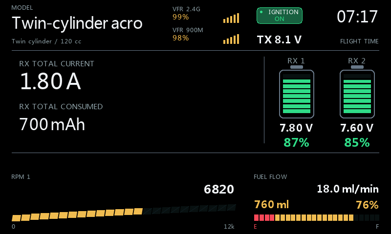</a> <b>1 RPM / 0 temperaturfelt</b></td>
<td><a href="images/native-gasdeck-deck-rpm1-temp1.png">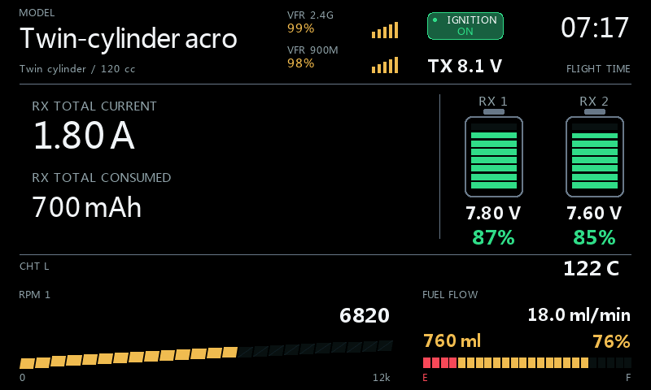</a> <b>1 RPM / 1 temperaturfelt</b></td>
<td><a href="images/native-gasdeck-deck-rpm1-temp2.png">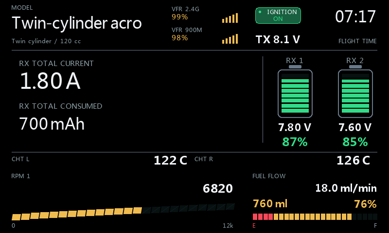</a> <b>1 RPM / 2 temperaturfelt</b></td>
<td><a href="images/native-gasdeck-deck-rpm1-temp3.png">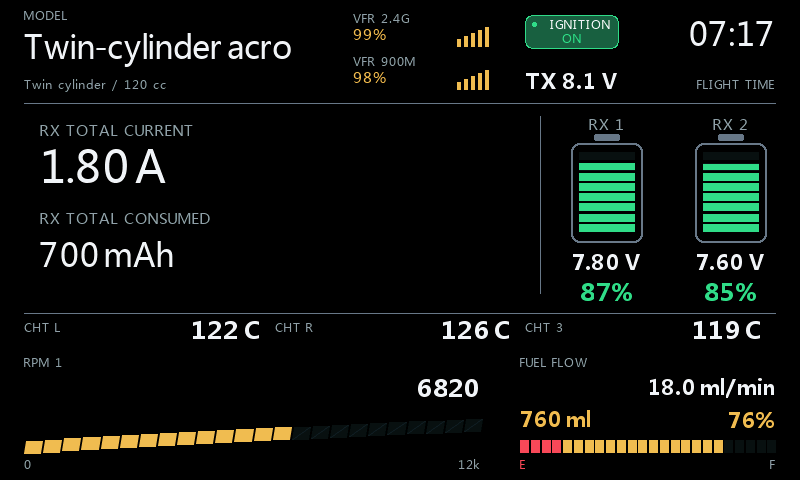</a> <b>1 RPM / 3 temperaturfelt</b></td>
<td><a href="images/native-gasdeck-deck-rpm1-temp4.png">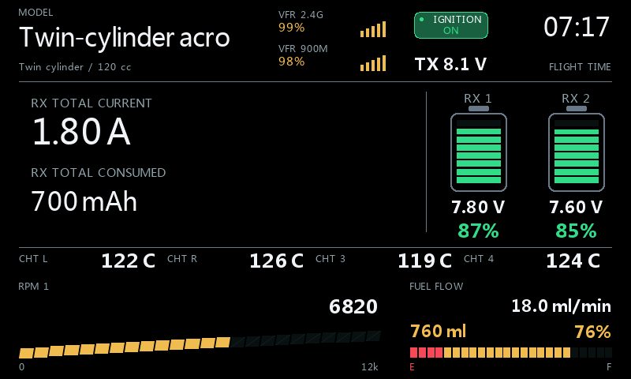</a> <b>1 RPM / 4 temperaturfelt</b></td>
</tr>
<tr>
<td><a href="images/native-gasdeck-deck-rpm2-temp0.png">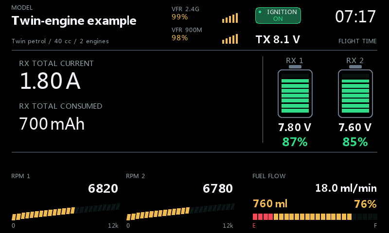</a> <b>2 RPM / 0 temperaturfelt</b></td>
<td><a href="images/native-gasdeck-deck-rpm2-temp1.png">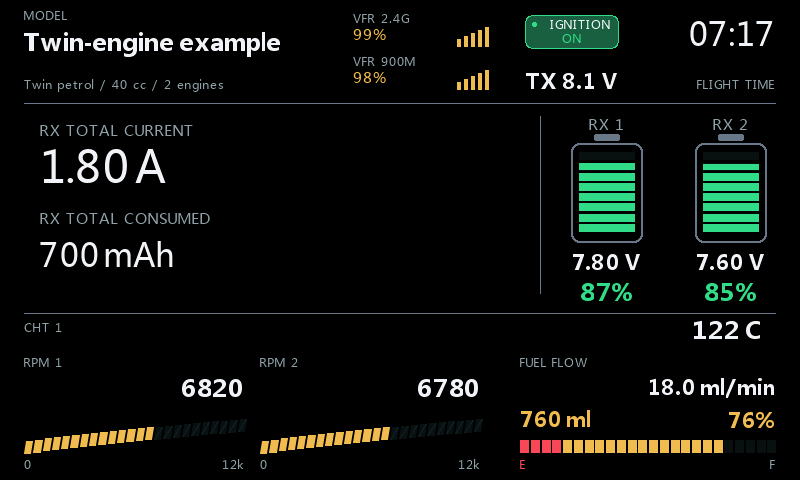</a> <b>2 RPM / 1 temperaturfelt</b></td>
<td><a href="images/native-gasdeck-deck-rpm2-temp2.png">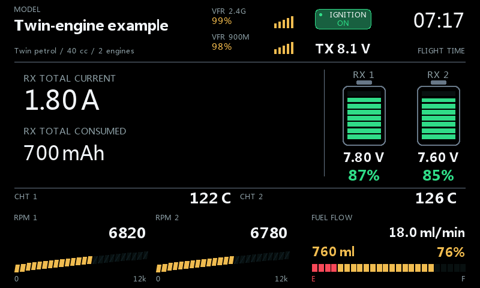</a> <b>2 RPM / 2 temperaturfelt</b></td>
<td><a href="images/native-gasdeck-deck-rpm2-temp3.png">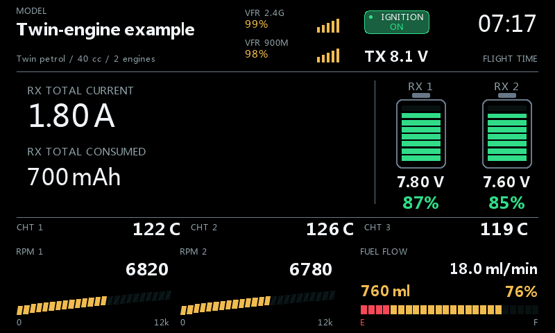</a> <b>2 RPM / 3 temperaturfelt</b></td>
<td><a href="images/native-gasdeck-deck-rpm2-temp4.png">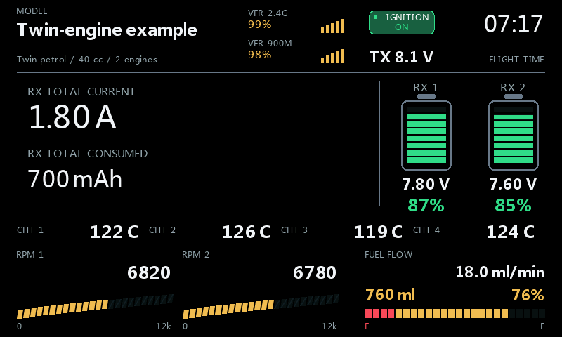</a> <b>2 RPM / 4 temperaturfelt</b></td>
</tr>
<tr>
<td><a href="images/native-gasdeck-deck-rpm3-temp0.png">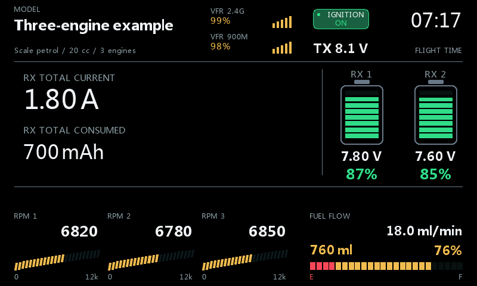</a> <b>3 RPM / 0 temperaturfelt</b></td>
<td><a href="images/native-gasdeck-deck-rpm3-temp1.png">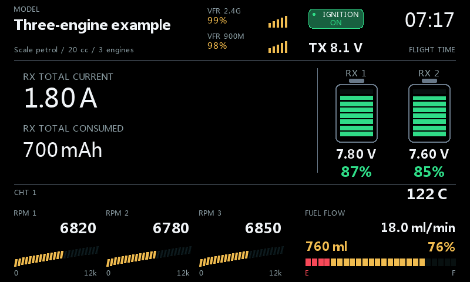</a> <b>3 RPM / 1 temperaturfelt</b></td>
<td><a href="images/native-gasdeck-deck-rpm3-temp2.png">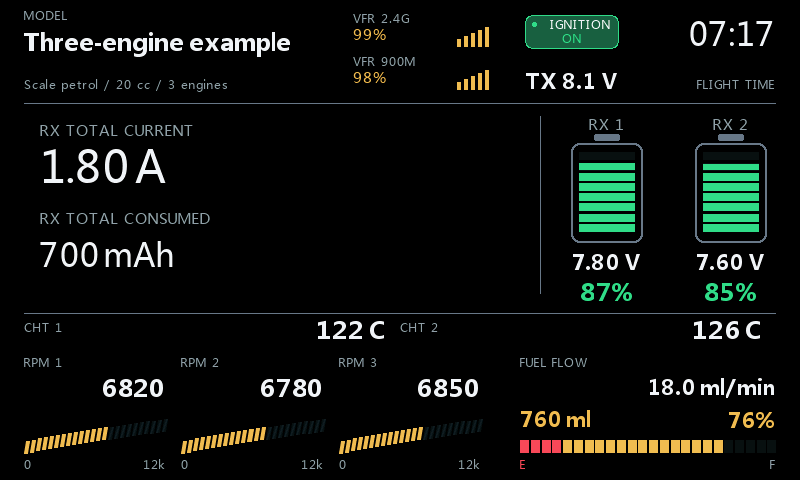</a> <b>3 RPM / 2 temperaturfelt</b></td>
<td> <b>3 RPM / 3 temperaturfelt</b></td>
<td><a href="images/native-gasdeck-deck-rpm3-temp4.png">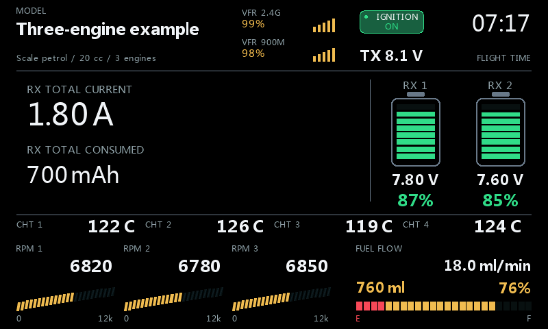</a> <b>3 RPM / 4 temperaturfelt</b></td>
</tr>
<tr>
<td><a href="images/native-gasdeck-deck-rpm4-temp0.png">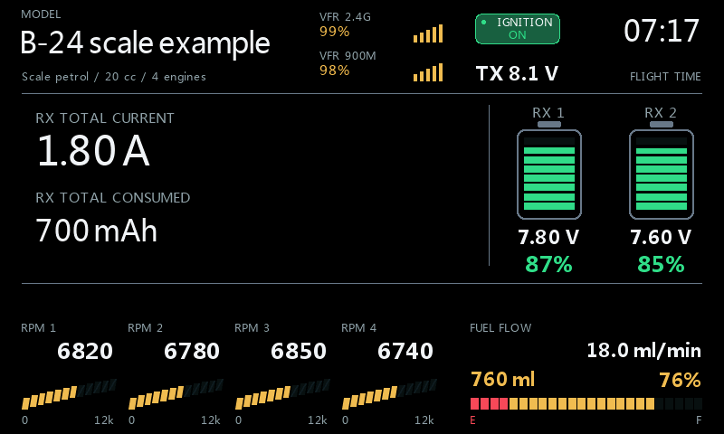</a> <b>4 RPM / 0 temperaturfelt</b></td>
<td><a href="images/native-gasdeck-deck-rpm4-temp1.png">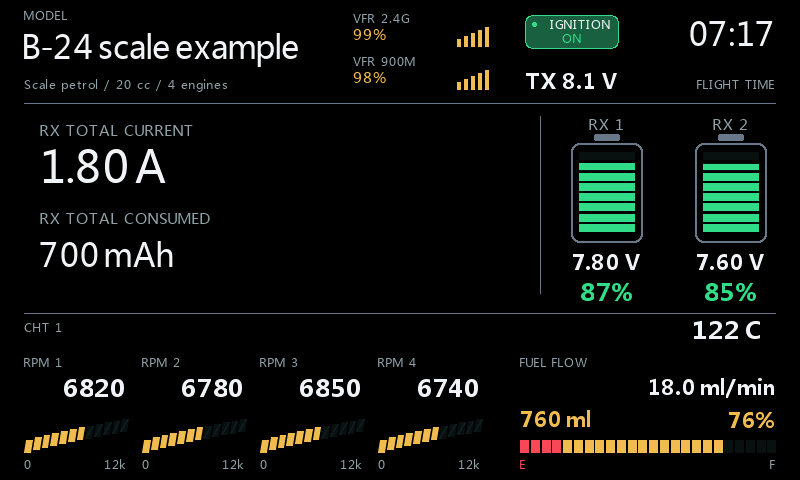</a> <b>4 RPM / 1 temperaturfelt</b></td>
<td><a href="images/native-gasdeck-deck-rpm4-temp2.png">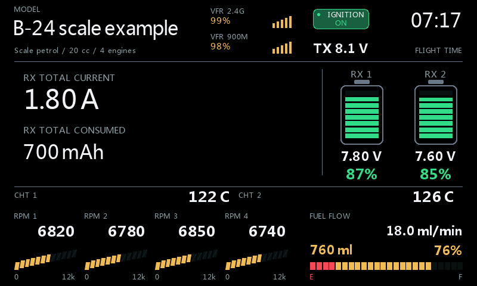</a> <b>4 RPM / 2 temperaturfelt</b></td>
<td><a href="images/native-gasdeck-deck-rpm4-temp3.png">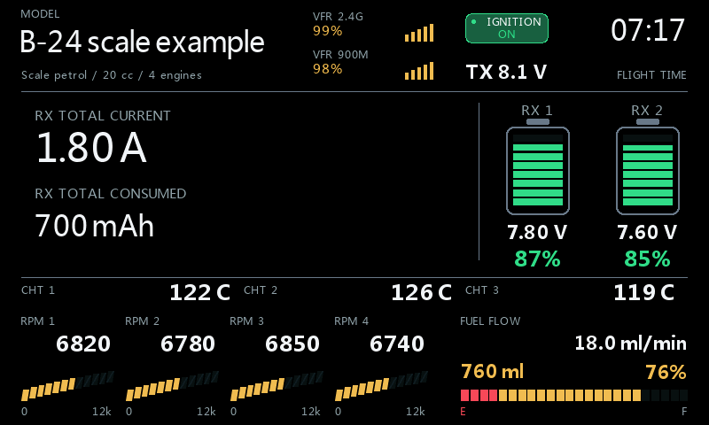</a> <b>4 RPM / 3 temperaturfelt</b></td>
<td> <b>4 RPM / 4 temperaturfelt</b></td>
</tr>
</table>
### Digital

0 RPM / 0 temperaturfelt

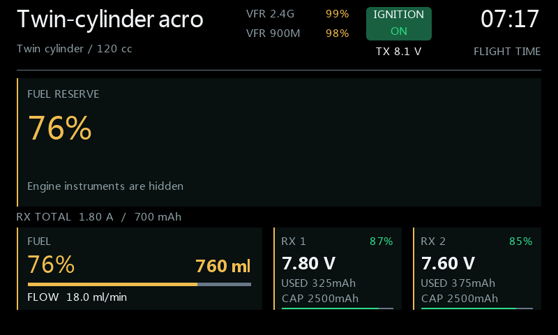

Valg: **Display style = Digital**; **Image source = Hidden**; **Engine count = 1**; **RPM displays = 0**; **Temp displays = 0**; **RPM style = Retro LCD**; **Tank value from = Integrate flow**; **RX1 / RX2 remaining = Consumed mAh / Consumed mAh**.

0 RPM / 1 temperaturfelt

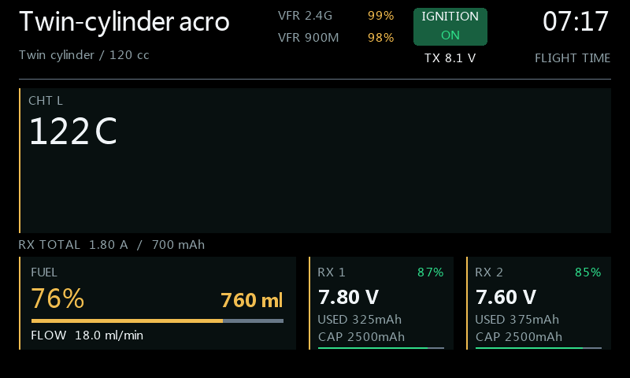

Valg: **Display style = Digital**; **Image source = Hidden**; **Engine count = 1**; **RPM displays = 0**; **Temp displays = 1**; **RPM style = Retro LCD**; **Tank value from = Integrate flow**; **RX1 / RX2 remaining = Consumed mAh / Consumed mAh**.

1 RPM / 0 temperaturfelt

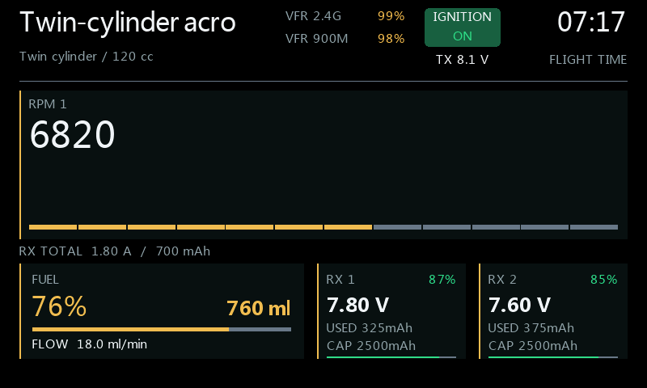

Valg: **Display style = Digital**; **Image source = Hidden**; **Engine count = 1**; **RPM displays = 1**; **Temp displays = 0**; **RPM style = Retro LCD**; **Tank value from = Integrate flow**; **RX1 / RX2 remaining = Consumed mAh / Consumed mAh**.

1 RPM / 1 temperaturfelt

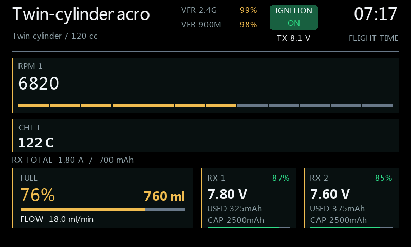

Valg: **Display style = Digital**; **Image source = Hidden**; **Engine count = 1**; **RPM displays = 1**; **Temp displays = 1**; **RPM style = Retro LCD**; **Tank value from = Integrate flow**; **RX1 / RX2 remaining = Consumed mAh / Consumed mAh**.

1 RPM / 2 temperaturfelt

Valg: **Display style = Digital**; **Image source = Hidden**; **Engine count = 1**; **RPM displays = 1**; **Temp displays = 2**; **RPM style = Retro LCD**; **Tank value from = Integrate flow**; **RX1 / RX2 remaining = Consumed mAh / Consumed mAh**.

2 RPM / 2 temperaturfelt

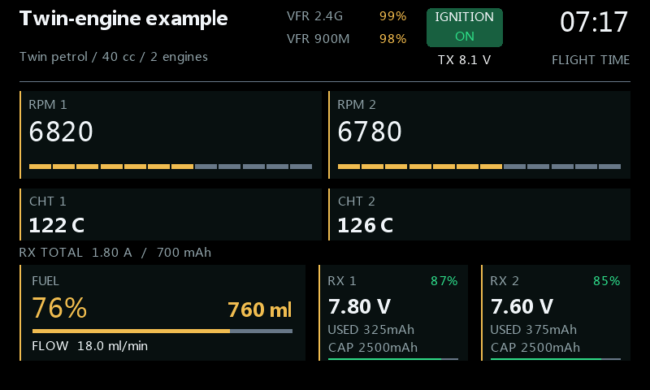

Valg: **Display style = Digital**; **Image source = Hidden**; **Engine count = 2**; **RPM displays = 2**; **Temp displays = 2**; **RPM style = Retro LCD**; **Tank value from = Integrate flow**; **RX1 / RX2 remaining = Consumed mAh / Consumed mAh**.

2 RPM / 4 temperaturfelt

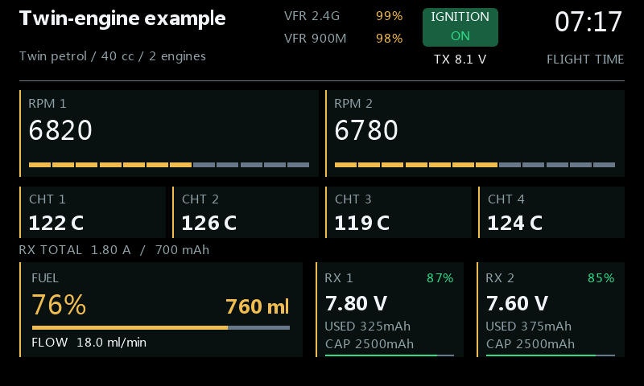

Valg: **Display style = Digital**; **Image source = Hidden**; **Engine count = 2**; **RPM displays = 2**; **Temp displays = 4**; **RPM style = Retro LCD**; **Tank value from = Integrate flow**; **RX1 / RX2 remaining = Consumed mAh / Consumed mAh**.

3 RPM / 3 temperaturfelt

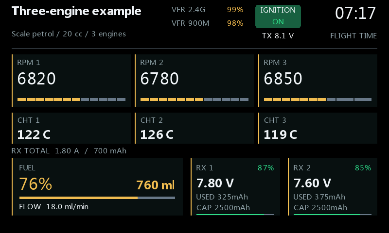

Valg: **Display style = Digital**; **Image source = Hidden**; **Engine count = 3**; **RPM displays = 3**; **Temp displays = 3**; **RPM style = Retro LCD**; **Tank value from = Integrate flow**; **RX1 / RX2 remaining = Consumed mAh / Consumed mAh**.

4 RPM / 4 temperaturfelt

Valg: **Display style = Digital**; **Image source = Hidden**; **Engine count = 4**; **RPM displays = 4**; **Temp displays = 4**; **RPM style = Retro LCD**; **Tank value from = Integrate flow**; **RX1 / RX2 remaining = Consumed mAh / Consumed mAh**.

## Firemotorseksempel med riktig modellbilde

<table>
<tr>
<td><a href="images/native-gasdeck-quad-deck-photo.png">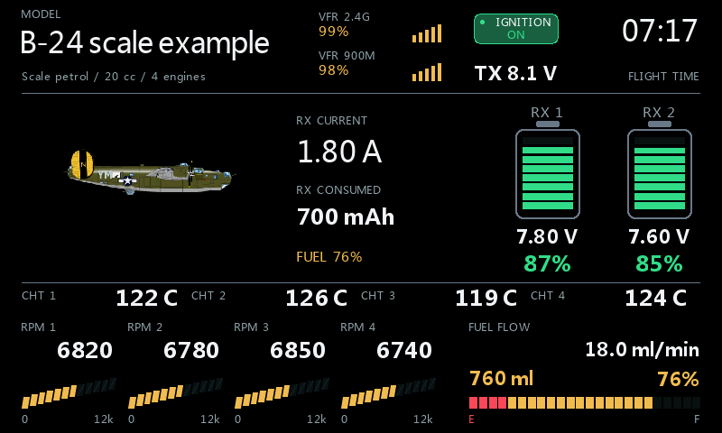</a> <b>Four-engine B-24 / Deck / picture</b></td>
<td><a href="images/native-gasdeck-quad-deck-hidden.png">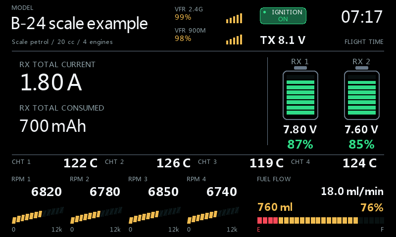</a> <b>Four-engine B-24 / Deck / Hidden</b></td>
</tr>
<tr>
<td><a href="images/native-gasdeck-quad-digital-photo.png">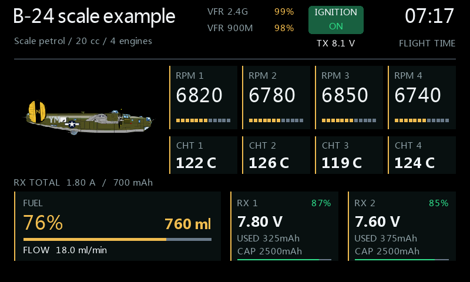</a> <b>Four-engine B-24 / Digital / picture</b></td>
<td><a href="images/native-gasdeck-quad-digital-hidden.png">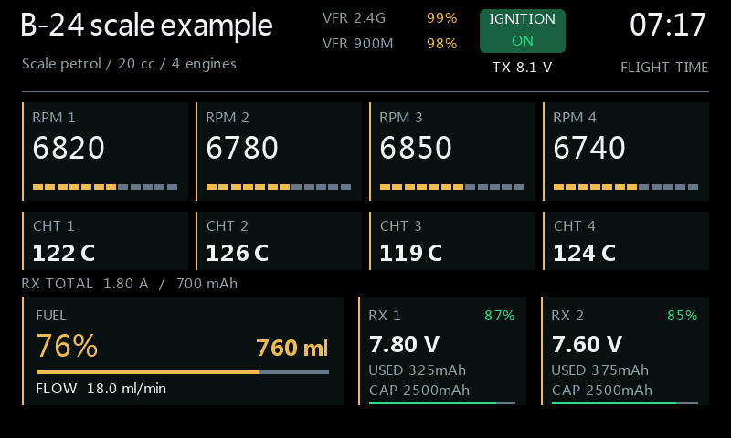</a> <b>Four-engine B-24 / Digital / Hidden</b></td>
</tr>
</table>

## RPM-presentasjon

Deck / Numeric RPM

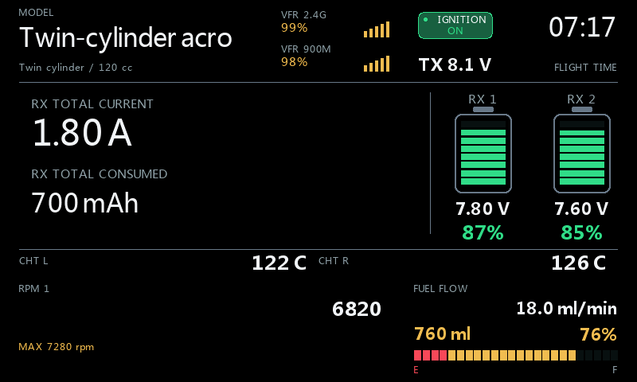

Valg: **Display style = Deck**; **Image source = Hidden**; **Engine count = 1**; **RPM displays = 1**; **Temp displays = 2**; **RPM style = Numeric**; **Tank value from = Integrate flow**; **RX1 / RX2 remaining = Consumed mAh / Consumed mAh**.

Digital / Numeric RPM

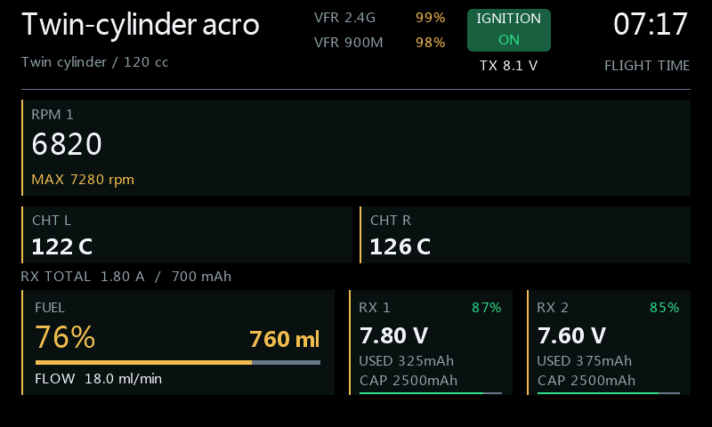

Valg: **Display style = Digital**; **Image source = Hidden**; **Engine count = 1**; **RPM displays = 1**; **Temp displays = 2**; **RPM style = Numeric**; **Tank value from = Integrate flow**; **RX1 / RX2 remaining = Consumed mAh / Consumed mAh**.

## Drivstoffmetoder

Capacity - consumed

Valg: **Display style = Digital**; **Image source = Hidden**; **Engine count = 1**; **RPM displays = 1**; **Temp displays = 2**; **RPM style = Retro LCD**; **Tank value from = Capacity - consumed**; **RX1 / RX2 remaining = Consumed mAh / Consumed mAh**.

Integrate flow

Valg: **Display style = Digital**; **Image source = Hidden**; **Engine count = 1**; **RPM displays = 1**; **Temp displays = 2**; **RPM style = Retro LCD**; **Tank value from = Integrate flow**; **RX1 / RX2 remaining = Consumed mAh / Consumed mAh**.

Remaining volume

Valg: **Display style = Digital**; **Image source = Hidden**; **Engine count = 1**; **RPM displays = 1**; **Temp displays = 2**; **RPM style = Retro LCD**; **Tank value from = Remaining volume**; **RX1 / RX2 remaining = Consumed mAh / Consumed mAh**.

Remaining percent

Valg: **Display style = Digital**; **Image source = Hidden**; **Engine count = 1**; **RPM displays = 1**; **Temp displays = 2**; **RPM style = Retro LCD**; **Tank value from = Remaining percent**; **RX1 / RX2 remaining = Consumed mAh / Consumed mAh**.

## RX-batterimetoder

Consumed mAh

Valg: **Display style = Digital**; **Image source = Hidden**; **Engine count = 1**; **RPM displays = 1**; **Temp displays = 2**; **RPM style = Retro LCD**; **Tank value from = Integrate flow**; **RX1 / RX2 remaining = Consumed mAh / Consumed mAh**.

Percent sensor

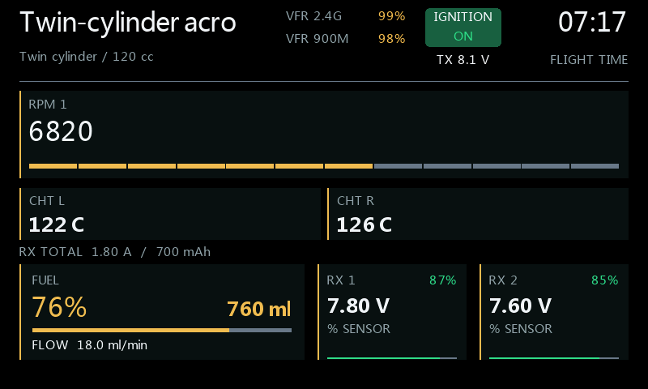

Valg: **Display style = Digital**; **Image source = Hidden**; **Engine count = 1**; **RPM displays = 1**; **Temp displays = 2**; **RPM style = Retro LCD**; **Tank value from = Integrate flow**; **RX1 / RX2 remaining = % sensor / % sensor**.

Voltage estimate

Valg: **Display style = Digital**; **Image source = Hidden**; **Engine count = 1**; **RPM displays = 1**; **Temp displays = 2**; **RPM style = Retro LCD**; **Tank value from = Integrate flow**; **RX1 / RX2 remaining = Voltage estimate / Voltage estimate**.

RX1 consumed mAh / RX2 voltage estimate

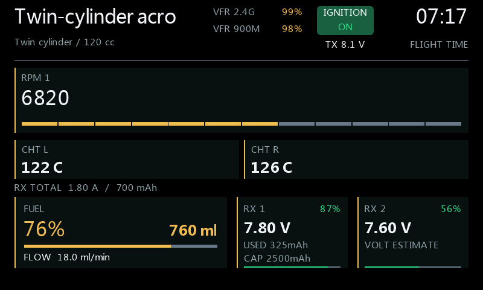

Valg: **Display style = Digital**; **Image source = Hidden**; **Engine count = 1**; **RPM displays = 1**; **Temp displays = 2**; **RPM style = Retro LCD**; **Tank value from = Integrate flow**; **RX1 / RX2 remaining = Consumed mAh / Voltage estimate**.

## Temperaturenheter

Fahrenheit temperature labels

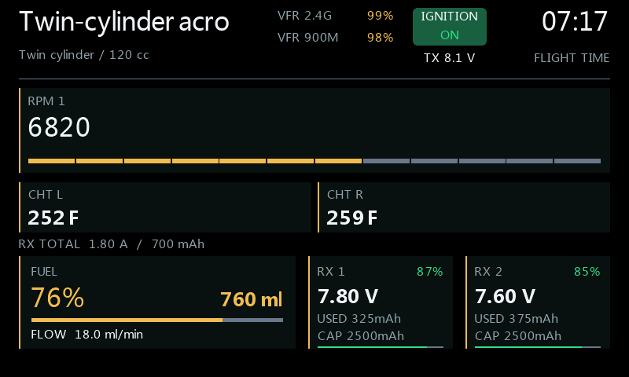

Valg: **Display style = Digital**; **Image source = Hidden**; **Engine count = 1**; **RPM displays = 1**; **Temp displays = 2**; **RPM style = Retro LCD**; **Tank value from = Integrate flow**; **RX1 / RX2 remaining = Consumed mAh / Consumed mAh**; **Temperature unit = Fahrenheit**.

## Tema og farger

Radio theme

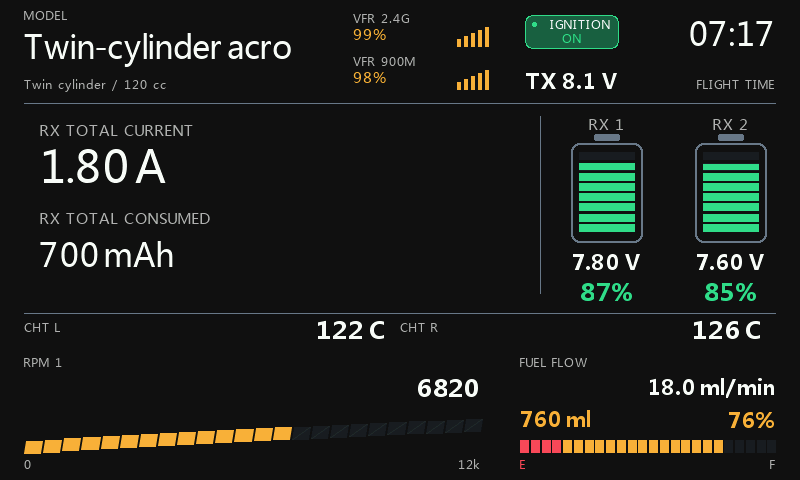

Valg: **Display style = Deck**; **Image source = Hidden**; **Engine count = 1**; **RPM displays = 1**; **Temp displays = 2**; **RPM style = Retro LCD**; **Tank value from = Integrate flow**; **RX1 / RX2 remaining = Consumed mAh / Consumed mAh**; **Background = Radio theme**.

Custom background/accent

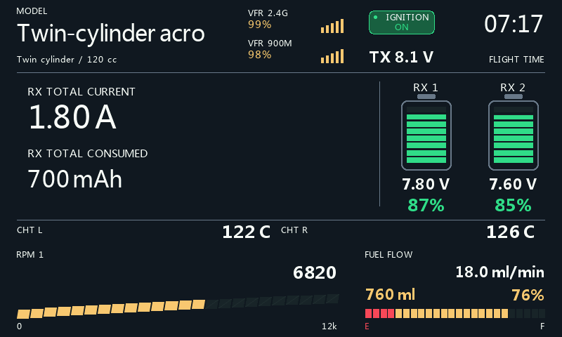

Valg: **Display style = Deck**; **Image source = Hidden**; **Engine count = 1**; **RPM displays = 1**; **Temp displays = 2**; **RPM style = Retro LCD**; **Tank value from = Integrate flow**; **RX1 / RX2 remaining = Consumed mAh / Consumed mAh**; **Background = Custom**.

## RF

Three independent RF displays

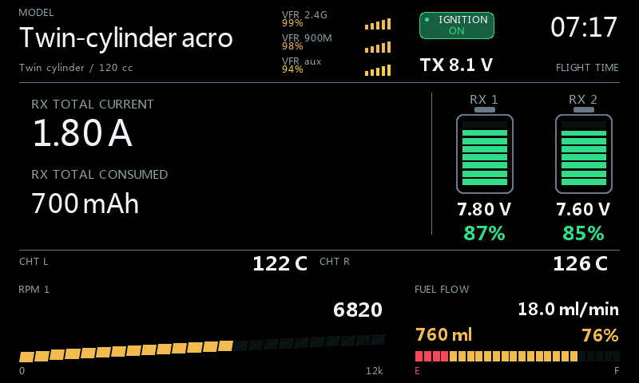

Valg: **Display style = Deck**; **Image source = Hidden**; **Engine count = 1**; **RPM displays = 1**; **Temp displays = 2**; **RPM style = Retro LCD**; **Tank value from = Integrate flow**; **RX1 / RX2 remaining = Consumed mAh / Consumed mAh**; **RF displays = 3**.

## Manglende data og varsling

Configured engine sources unavailable

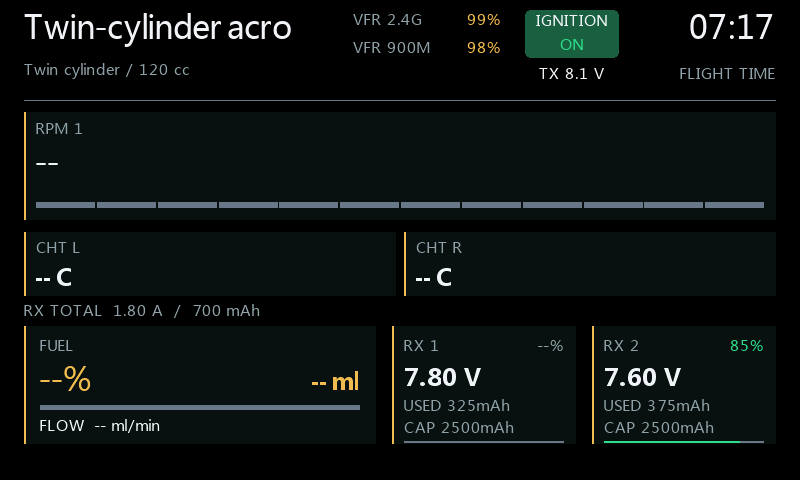

Valg: **Display style = Digital**; **Image source = Hidden**; **Engine count = 1**; **RPM displays = 1**; **Temp displays = 2**; **RPM style = Retro LCD**; **Tank value from = Integrate flow**; **RX1 / RX2 remaining = Consumed mAh / Consumed mAh**.

## Øvrige valg og kildeavhengigheter

Dette galleriet dekker de ulike visningsvalgene; det er ikke alle kombinasjoner av egendefinerte farger, sensornavn og tallverdier. **Radio theme / Black / Custom**, egen aksentfarge og valgfri font kan tilpasses uavhengig. La Font file være tom for native ETHOS-fonter. Fullskjerm betyr hele LCD-flaten til radioen, også ved lavere oppløsning.

Hvert RX-batteri velges som **LiPo / LiFe**, med eget celletall og metode. Drivstoff kan beregnes fra **Capacity - consumed / Integrate flow / Remaining volume / Remaining percent**. Bruk **ml eller L** for volum og **ml/min, L/min eller ml/s** for flow etter kildens faktiske enhet; visningen bruker ml og ml/min. RF har 1–3 faktiske kilder. RPM-/temperaturgrenser, reservemengde, alarmer og flylogg er forklart i oppsettsguiden.

Grå felt beholder verdiene sine. En kilde kan fortsatt være nødvendig for beregning, alarm eller logg når et instrument er skjult. Manglende måling vises som ukjent, ikke null eller fullt. Behold ekte Synthetic preview-varsel og slå Preview av ved vanlig bruk. Se [oppsettsguiden](Konfigurasjon-norsk.md) for full feltreferanse og [NOTICE](../NOTICE.md) for modellbilder.

B-24: [charner1963, Wikimedia Commons / Openclipart, CC0 1.0](https://commons.wikimedia.org/wiki/File:Consolidated_B-24_Liberator.svg).
